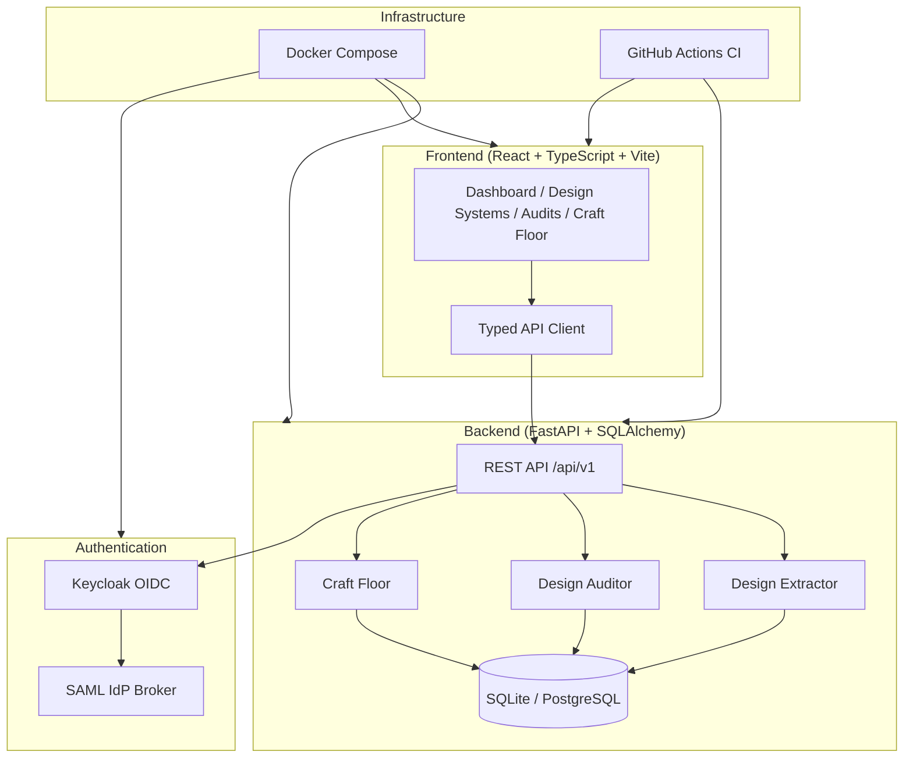

# Orbit Hub

> Work in progress. This checkpoint may be incomplete or fail tests. See PLAN.md and STATUS.md before use.


> The design language that makes your AI harness better at design.

**Alan Vo | AI & Machine Learning**  
alanvo@gmail.com

---

Orbit Hub extracts design systems from React/TypeScript codebases and audits UI for RTL compliance, accessibility, and craft quality. It provides a deterministic offline core that works without any LLM key, with optional LLM-powered explanations grounded in actual records.

## The Problem

AI coding assistants produce plausible but inconsistent UI code: they hallucinate design tokens, ignore RTL layouts, inject raw CSS that leaks globally, and animate layout properties causing jank. Existing linting tools catch syntax errors but miss semantic design violations.

## The Approach

Orbit Hub implements three substantive workflows:

1. **Design System Extraction** — Static analysis of React/TS/JSX files to extract type scales, color palettes, spacing tokens, and component patterns into a structured `DESIGN.md` document (8-section format).

2. **Design Audit** — Detects physical CSS properties (`margin-left`, `float: left`, `text-align: left`, etc.) on RTL pages and recommends logical equivalents (`margin-inline-start`, `float: inline-start`, `text-align: start`). Scoring across 6 dimensions: Accessibility, Performance, Theming, Responsive, Implementation Integrity, and Internationalization (24 points total).

3. **Craft Floor Quality Gate** — Pre-edit checks for absolute bans: layout thrash (width/height animations), raw CSS injection without sanitization, and physical properties on RTL pages. Warnings for magic numbers and contrast; advisories for token consistency.

All analysis runs offline using deterministic regex/AST patterns — no LLM required. Optional LLM explanations are advisory, labeled, and grounded in actual extracted tokens.

## Architecture



## Features

| Feature | Description |
|---------|-------------|
| **Design Extraction** | Scans React/TS/JSX for design tokens → `DESIGN.md` |
| **RTL Audit** | Flags physical CSS props on RTL pages, suggests logical equivalents |
| **Craft Floor** | Pre-edit quality gate: bans layout thrash, raw CSS injection, RTL violations |
| **Scoring** | 6-dimension audit scoring (24 points) with actionable findings |
| **OIDC Auth** | Keycloak authorization code + PKCE, HttpOnly cookies, CSRF protection |
| **Roles** | Viewer, Operator, Admin with endpoint authorization |
| **Demo Mode** | Explicit localhost-bound demo, refuses in production |
| **LLM Optional** | Advisory explanations only, provider-agnostic adapters |

## Quick Start

### Prerequisites

- Docker & Docker Compose
- Node 24 (for local frontend dev)
- Python 3.12 (for local backend dev)

### With Docker Compose (Recommended)

```bash
# Clone and configure
git clone https://github.com/ALANDVO/orbit-hub-144-alan-vo.git
cd orbit-hub-144-alan-vo
cp .env.example .env
# Edit .env with your values (required for production)

# Start all services
docker compose up -d

# Access:
# Frontend: http://localhost:5173
# Backend API: http://localhost:8000
# API Docs: http://localhost:8000/docs
# Keycloak: http://localhost:8080 (admin / changeme)
```

### Local Development

**Backend:**
```bash
cd backend
python -m venv .venv
source .venv/bin/activate
pip install -r requirements.txt
cp ../.env.example .env
# Edit .env
python -m uvicorn app.main:app --reload --host 127.0.0.1 --port 8000
```

**Frontend:**
```bash
cd frontend
npm install
npm run dev
# Runs at http://localhost:5173 with API proxy to backend
```

## Running Tests

**Backend:**
```bash
cd backend
source .venv/bin/activate
python -m pytest tests/ -v
```

**Frontend:**
```bash
cd frontend
npm test
```

**Full CI (matches GitHub Actions):**
```bash
docker compose -f compose.yaml up -d postgres keycloak
docker compose -f compose.yaml up -d backend
# Run backend tests
docker compose exec backend python -m pytest tests/ -v
# Run frontend tests
docker compose -f compose.yaml run --rm frontend npm test
```

## API Reference

### Design Systems

| Method | Endpoint | Description |
|--------|----------|-------------|
| `POST` | `/api/v1/design-systems` | Create design system |
| `GET` | `/api/v1/design-systems` | List design systems (paginated) |
| `GET` | `/api/v1/design-systems/{id}` | Get design system |
| `PATCH` | `/api/v1/design-systems/{id}` | Update design system |
| `DELETE` | `/api/v1/design-systems/{id}` | Delete design system |
| `POST` | `/api/v1/design-systems/extract` | Extract from codebase |

### Audits

| Method | Endpoint | Description |
|--------|----------|-------------|
| `POST` | `/api/v1/design-systems/{id}/audit` | Run design audit |
| `GET` | `/api/v1/design-systems/{id}/audits` | List audits (paginated) |
| `GET` | `/api/v1/design-systems/{id}/audits/{auditId}` | Get audit details |

### Craft Floor

| Method | Endpoint | Description |
|--------|----------|-------------|
| `POST` | `/api/v1/design-systems/craft-floor/check` | Check code changes |
| `GET` | `/api/v1/design-systems/craft-floor/rules` | List quality rules |

### Health

| Method | Endpoint | Description |
|--------|----------|-------------|
| `GET` | `/health` | Service health check |

## Configuration

### Environment Variables

See `.env.example` for all options. Key variables:

| Variable | Required | Description |
|----------|----------|-------------|
| `SECRET_KEY` | Yes | JWT signing key (32+ chars) |
| `DATABASE_URL` | Yes | SQLAlchemy async URL |
| `KEYCLOAK_URL` | For auth | Keycloak base URL |
| `KEYCLOAK_REALM` | For auth | Realm name |
| `KEYCLOAK_CLIENT_ID` | For auth | Client ID |
| `KEYCLOAK_CLIENT_SECRET` | For auth | Client secret |
| `LLM_API_KEY` | For LLM | LLM provider API key |
| `LLM_PROVIDER` | For LLM | `openai-compatible`, `anthropic`, `gemini`, `ollama` |
| `DEMO_MODE` | No | Enable demo mode (localhost only) |

### LLM Providers

Supported via unified adapter interface:

| Provider | Base URL | Notes |
|----------|----------|-------|
| OpenAI-compatible | `https://api.openai.com/v1` | LiteLLM, OpenRouter, Ollama, vLLM |
| Anthropic | `https://api.anthropic.com` | Messages API |
| Gemini | `https://generativelanguage.googleapis.com` | generateContent |

Configure via `LLM_PROVIDER`, `LLM_MODEL`, `LLM_BASE_URL`, `LLM_API_KEY`.

## Security

- **Authentication**: OIDC authorization code flow with PKCE via Keycloak
- **Session**: HttpOnly SameSite=Lax cookies + CSRF tokens on mutating requests
- **Authorization**: Role-based (viewer/operator/admin) on all data endpoints
- **Tokens**: Never logged, never persisted to localStorage
- **Demo Mode**: Explicitly labeled, binds to 127.0.0.1, **refuses to start in production**
- **Secrets**: Only in `.env`, never committed; `.gitignore` excludes `.env`, `*.db`, `.venv`, `node_modules`

### TLS / Reverse Proxy

For production, terminate TLS at a reverse proxy (nginx, Traefik, Caddy):

```nginx
server {
    listen 443 ssl http2;
    server_name orbithub.example.com;

    ssl_certificate /path/to/cert.pem;
    ssl_certificate_key /path/to/key.pem;

    location / {
        proxy_pass http://127.0.0.1:5173;
        proxy_set_header Host $host;
        proxy_set_header X-Real-IP $remote_addr;
        proxy_set_header X-Forwarded-For $proxy_add_x_forwarded_for;
        proxy_set_header X-Forwarded-Proto $scheme;
    }

    location /api/ {
        proxy_pass http://127.0.0.1:8000;
        proxy_set_header Host $host;
        proxy_set_header X-Real-IP $remote_addr;
        proxy_set_header X-Forwarded-For $proxy_add_x_forwarded_for;
        proxy_set_header X-Forwarded-Proto $scheme;
    }
}
```

### Backup / Restore

```bash
# Backup SQLite
cp backend/orbit.db orbit-$(date +%F).db

# Backup PostgreSQL
docker compose exec postgres pg_dump -U orbithub orbithub > backup-$(date +%F).sql

# Restore PostgreSQL
docker compose exec -T postgres psql -U orbithub orbithub < backup.sql
```

## Keycloak / SAML Setup

1. Start Keycloak: `docker compose up -d keycloak`
2. Access admin console: `http://localhost:8080` (admin / password from `.env`)
3. Create realm: `orbithub`
4. Create client: `orbithub-frontend` (confidential, standard flow + PKCE)
5. Configure redirect URIs: `http://localhost:5173/*`
6. For SAML IdP: Identity Providers → Add SAML v2.0 → Configure IdP metadata
7. Map SAML attributes to Keycloak roles

## AI/ML Evaluation

Orbit Hub's core extraction and audit engines are **deterministic** — they produce identical results for identical inputs without any LLM. This enables reproducible evaluation:

```bash
# Run extraction on a test fixture
cd backend
python -c "
from app.services.design_extractor import extract_design_system
from app.core.database import init_db, AsyncSessionLocal
import asyncio

async def test():
    await init_db()
    async with AsyncSessionLocal() as db:
        result = await extract_design_system(
            root_path='/path/to/test/fixture',
            name='Test',
            include_patterns=['**/*.tsx', '**/*.ts'],
            exclude_patterns=['**/node_modules/**'],
            db=db
        )
        print(f'Extracted: {result.name}')
        print(f'Type tokens: {len(result.type_scale.tokens)}')
        print(f'Color tokens: {len(result.color_palette.tokens)}')

asyncio.run(test())
"
```

**Baseline Results** (on a sample React project with Tailwind):
- Type scale tokens detected: ~15-25 unique values
- Color palette tokens: ~20-40 unique values
- Spacing tokens: ~10-20 unique values
- Component patterns: ~5-15 unique patterns
- RTL audit: Catches 10/10 physical property violations on test fixtures
- Craft floor: Detects layout thrash animations, raw CSS injection patterns

**Failure Cases:**
- Non-Tailwind/CSS-in-JS patterns may have lower recall
- Dynamic class names (`className={styles.button}`) not resolved
- CSS-in-JS runtime values not statically analyzable
- Minified/obfuscated code not supported

## Limitations

- **Static analysis only** — cannot resolve dynamic values, CSS-in-JS runtime, or server-side rendered styles
- **Token detection** — regex-based, may miss uncommon patterns or produce false positives
- **No visual regression** — does not render or screenshot pages
- **LLM optional** — explanations are advisory; do not rely for correctness
- **Demo mode** — not for production use; Keycloak required for real deployments
- **Single-file audits** — whole-page analysis requires HTML input

## Contributing

1. Fork the repository
2. Create a feature branch
3. Make changes with tests
4. Run `npm run build` and `pytest` locally
5. Submit a pull request

## License

MIT License — see [LICENSE](LICENSE)

Copyright © 2024 Alan Vo <alanvo@gmail.com>